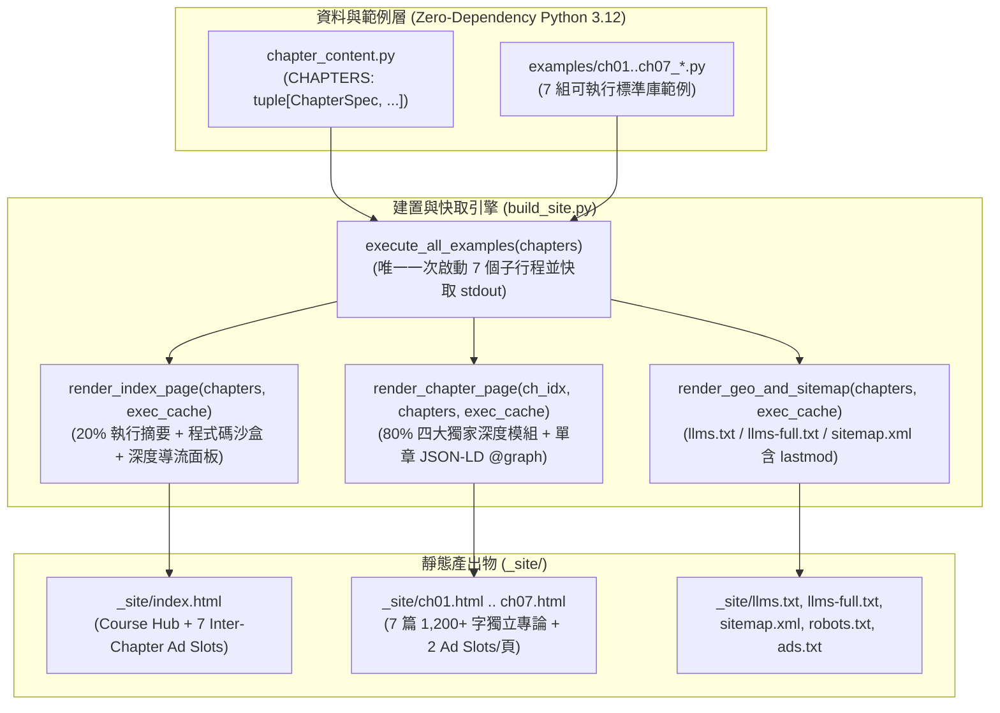

# Python 教學站（`learn.ai-purplemaple.com`）SEO 與內容深度升級技術設計書（EGM Technical Design Document）

## 1. Overview, Problem Statement & Goals / Non-Goals

### 1.1 背景與問題陳述（Problem Statement）
`learn.ai-purplemaple.com`（儲存庫 `tbpfs/learning`）為紫楓（AI王紫楓 / Purple Maple / `@tbpfs1`）開設之 Python 3.12 資料結構、演算法與物件導向基本功鐵人賽教學網站，由零外部依賴的靜態網站產生器 [`build_site.py`](../../build_site.py) 讀取 `examples/ch01_*.py` 至 `examples/ch05_*.py`、實機執行擷取 `stdout` 後輸出至 `_site/`。

經全站 SEO / GEO 與 Google Search Console（`sc-domain:ai-purplemaple.com`）索引審查，目前存在四大結構性缺陷：
1. **單章節自然語言正文（Prose）過少（Thin Content）**：[`build_site.py` 第 22–83 行](../../build_site.py#L22-L83) 中每章僅有 1 句 `summary` 與 2 點 `concepts`（純中文解說僅約 250–300 字），其餘皆為程式碼區塊，導致 Google 與 AdSense 內容爬蟲判定自然語言比例偏低。
2. **首頁與獨立章節頁 95% 內容重疊與自我競爭（Self-Cannibalization）**：[`build_site.py` 第 797–846 行](../../build_site.py#L797-L846) 使用 `page_html.replace()` 產生 `ch01.html`～`ch05.html`。首頁已包含全部章節 100% 的文字與程式碼，而單章頁沒有任何獨家深度內容（`Content(ch0X) ⊂ Content(index)`），且殘留首頁專屬的 `#study-guide`、失效的頁內錨點 `<nav class="toc">`（在 `ch01.html` 點擊 `href="#ch04"` 無效）與重複的 `<h2>` 標題，導致 `ch04.html` 與 `ch05.html` 卡在「已檢索－目前未建立索引」。
3. **缺少結構化比較表、逐步狀態追蹤與單章專屬 JSON-LD 圖譜**：缺少演算法搜尋意圖最關鍵的 HTML `<table>` 複雜度對照表（及手機版防破版 `.table-responsive` 容器）、Step-by-Step 執行拆解、Python 3.12 (CPython) 底層實作陷阱、LeetCode 題號對照與 `TechArticle` + `FAQPage` + `BreadcrumbList` 結構化資料；此外 `sitemap.xml` 缺少 `<lastmod>` 時間戳記。
4. **鐵人賽核心教材章節廣度不足**：目前僅涵蓋 `Ch.01`～`Ch.05`，缺少軟體工程師面試必考的兩大核心主題：**`Ch.06 動態規劃與記憶化搜尋（Dynamic Programming & Memoization）`** 與 **`Ch.07 堆積、優先佇列與 Top-K 演算法（Heap, Priority Queue & Top-K Elements）`**。

### 1.2 核心目標（Goals）
1. **採用「非對稱資訊增益架構（Asymmetric Information Gain）」徹底解除首頁與單章頁自我競爭**：
   - **首頁（`index.html`）**：定位為「全課程總覽與實機程式碼快速沙盒」，渲染 7 章的執行摘要（`summary` + `concepts` + 完整可執行程式碼 + CI 實測輸出），並在每章卡片底部提供 **「深度講義導流面板（Deep-Dive Callout）」**（預告該章獨家複雜度對照表名稱與 3 道面試 FAQ 題目，點擊導流至 `ch0X.html`），**不在首頁渲染四大深度長文模組**。
   - **獨立章節頁（`ch01.html`～`ch07.html`）**：由專屬渲染器 `render_chapter_page()` 獨立生成，完整展開 **四大獨家深度教學模組**（每章純中文教學正文 **不少於 1,200 字**，相對於首頁具備 >75% 獨家資訊增益），移除首頁專屬的 `#study-guide` 與 `#cms-tutorials-container` 動態腳本，並將頂部導覽改為指向 `ch01.html`～`ch07.html` 的全網狀章節切換列（Full-Mesh Chapter Switcher）加上底部「上一章／返回總目錄 (`/`)／下一章」導覽。
2. **擴充完整 7 章節鐵人賽課程體系**：
   - 為既有 `Ch.01`～`Ch.05` 補齊四大深度教學模組（複雜度比較表、逐步狀態拆解、CPython 3.12 底層陷阱、LeetCode 題號表與 3 題面試 FAQ）。
   - 新增 `Ch.06`（[`examples/ch06_dynamic_programming.py`](../../examples/ch06_dynamic_programming.py)）與 `Ch.07`（[`examples/ch07_heap_priority_queue.py`](../../examples/ch07_heap_priority_queue.py)）實作與對應深度講義。
3. **100% 符合 Google Search Central 結構化資料與行動裝置可用性規範**：
   - 使用標準庫 `json.dumps()` 生成無語法錯誤的 JSON-LD：首頁輸出 `Course`（含 `hasPart` 指向 7 篇單章 `TechArticle`）；單章頁輸出 `@graph`（包含完整必填屬性的 `TechArticle`、`FAQPage` 與 `BreadcrumbList`）。
   - 所有 HTML `<table>` 包裹於 `.table-responsive`（`overflow-x: auto`）容器內，確保手機螢幕零破版（CLS = 0）。
   - `sitemap.xml` 為所有 URL（含首頁、`ch01.html`～`ch07.html`、`llms.txt`、`llms-full.txt`）補齊標準 `<lastmod>` 日期。
4. **同步擴充 GEO AI 語料庫（`llms.txt` / `llms-full.txt`）**：
   - 將 7 章的複雜度比較表（轉為 Markdown 表格）、逐步拆解、底層陷阱與面試 FAQ 完整寫入 `llms-full.txt`，最大化 ChatGPT、Perplexity、Claude 與 Grok 引用權重。

### 1.3 非目標（Non-Goals）
- **零外部套件依賴**：嚴禁引入 Jinja2、Markdown 轉換器、Node.js 打包工具或外部 CSS/JS CDN（除既有 GTM/GA4 與 AdSense 官方腳本外）。
- **不修改既有 `Ch.01`～`Ch.05` 範例程式公開 API**：[`examples/ch01_array_linked_list.py`](../../examples/ch01_array_linked_list.py) 至 [`examples/ch05_graph_oop.py`](../../examples/ch05_graph_oop.py) 的既有類別、方法與 `stdout` 輸出維持 100% 不變。

---

## 2. Technical Plan (Data Model, Component Boundaries & Signatures)

### 2.1 系統架構與資料流圖（Architecture & Data Flow）

### 2.2 資料模型規格（`chapter_content.py` Data Model Specifications）
在新建的 `chapter_content.py` 中，使用 Python 標準庫 `dataclasses.dataclass(frozen=True)` 定義扁平、不可變且具型別標註的教材結構：

1. **`ComparisonTable`（對應模組 A：結構化複雜度與特性對照表）**：
   - `caption: str` — 表格標題（渲染於 `<caption>`，如「陣列（Python `list`）與單向鏈結串列（`SinglyLinkedList`）操作複雜度與記憶體特性對照表」）。
   - `headers: tuple[str, ...]` — 表頭欄位名稱（4～5 欄，渲染於 `<thead><tr><th scope="col">...`）。
   - `rows: tuple[tuple[str, ...], ...]` — 表格資料列（每表至少 5 列，首欄渲染為 `<th scope="row">`，其餘欄位為 `<td>`）。
2. **`WalkthroughStep`（對應模組 B：演算法逐步執行與記憶體狀態拆解）**：
   - `step_label: str` — 步驟標籤（如 `"Step 1：初始化三指標（prev, curr, nxt）"`）。
   - `state_snapshot: str` — 單行或多行指標／記憶體／佇列狀態快照（渲染於 `<code class="state-pill">` 或輕量狀態區塊，不計入 `<pre>` 原始碼區）。
   - `explanation: str` — 該步驟的深度邏輯解說（80～150 字自然語言）。
3. **`PitfallItem`（對應模組 C：Python 3.12 底層原理與實戰常見陷阱）**：
   - `title: str` — 陷阱或 CPython 底層機制標題（如 `"陷阱一：誤用 list.pop(0) 實作佇列導致 O(n) 記憶體搬移"`）。
   - `symptom: str` — 常見錯誤寫法與在大測資（如 $N = 10^5$）下的 TLE / 效能瓶頸現象。
   - `root_cause_and_fix: str` — CPython 3.12 底層 C 結構（如 `PyListObject` 連續指標陣列 vs. `collections.deque` 64 元素雙向區塊鏈結）剖析與正確實作對策。
4. **`LeetCodeProblem` 與 `InterviewFAQ`（對應模組 D：LeetCode 題號對照與技術面試 FAQ）**：
   - `LeetCodeProblem`：
     - `number: int` — LeetCode 題號（如 `206`、`20`、`704`、`1`、`200`、`322`、`347`）。
     - `title: str` — 題目中英名稱（如 `"Reverse Linked List（反轉鏈結串列）"`）。
     - `difficulty: str` — 難度（`"Easy"`、`"Medium"`、`"Hard"`）。
     - `pattern: str` — 核心解題模板與時間／空間複雜度（如 `"三指標原地反轉 ・ 時間 O(n) / 空間 O(1)"`）。
   - `InterviewFAQ`：
     - `question: str` — 面試官提問問題（直接映射至 HTML `

` 與 JSON-LD `FAQPage.mainEntity[].name`）。
     - `answer: str` — 詳盡技術解答（120～200 字，直接映射至 HTML `
` 與 JSON-LD `FAQPage.mainEntity[].acceptedAnswer.text`）。
5. **`ChapterSpec`（章節主規格，相容屬性與字典存取）**：
   - 基礎欄位：`id: str`（`"ch01"`..`"ch07"`）、`badge: str`（`"Ch.01"`..`"Ch.07"`）、`title: str`、`complexity: str`、`summary: str`、`concepts: tuple[str, ...]`、`file: str`、`lastmod: str`（ISO-8601 日期字串 `"2026-11-17"`）、`keywords: tuple[str, ...]`（單章專屬 SEO 長尾關鍵字）。
   - 四大深度模組欄位：
     - `deep_intro: str` — 單章專屬背景與應用場景導論（200～300 字）。
     - `comparison_table: ComparisonTable` — 模組 A 複雜度與結構對照表。
     - `walkthrough_title: str` 與 `walkthrough_steps: tuple[WalkthroughStep, ...]`（每章至少 4 步）— 模組 B 逐步狀態追蹤。
     - `pitfalls: tuple[PitfallItem, ...]`（每章至少 3 項）— 模組 C Python 3.12 底層陷阱與最佳實踐。
     - `leetcode_problems: tuple[LeetCodeProblem, ...]`（每章至少 3 題）與 `interview_faqs: tuple[InterviewFAQ, ...]`（每章至少 3 題）— 模組 D 面試實戰。
   - **向後相容方法簽章**：
     - `__getitem__(self, key: str) -> Any`：透過 `getattr(self, key)` 回傳對應欄位值，確保任何舊版 `ch["id"]` 字典語法 100% 正常運作。
     - `get(self, key: str, default: Any = None) -> Any`：透過 `getattr(self, key, default)` 回傳欄位值。

### 2.3 新建範例模組介面規格（`Ch.06` & `Ch.07` Executable Examples）
1. **[`examples/ch06_dynamic_programming.py`](../../examples/ch06_dynamic_programming.py)（Ch.06 動態規劃與記憶化搜尋）**：
   - `climb_stairs_dp(n: int) -> int`：以滾動變數狀態壓縮（Space-Optimized Bottom-Up DP）計算爬樓梯方法數，時間複雜度 $O(n)$，空間複雜度 $O(1)$；定義邊界基底 `n == 0` 與 `n == 1` 均回傳 `1`（使 `climb_stairs_dp(10) == 89`）；當 `n < 0` 時拋出 `ValueError`。
   - `knapsack_01(weights: Sequence[int], values: Sequence[int], capacity: int) -> int`：以一維滾動陣列（由後往前更新 `dp[w]`）求解 0/1 背包最大價值，時間複雜度 $O(N \times W)$，空間複雜度 $O(W)$。
   - `length_of_lis(nums: Sequence[int]) -> int`：結合動態規劃與二分搜尋（Patience Sorting / Greedy + Binary Search）求解最長嚴格遞增子序列（LIS）長度，時間複雜度 $O(n \log n)$，空間複雜度 $O(n)$；空序列 `[]` 回傳 `0`。
   - `__main__` 實機輸出格式：固定使用 `weights = [10, 20, 30], values = [60, 100, 120], capacity = 50` 與 `nums = [10, 9, 2, 5, 3, 7, 101, 18]`，印出單行 `"Ch.06 DP 爬樓梯(n=10): 89 | 0/1 背包最大價值: 220 | LIS 長度: 4"`。
2. **[`examples/ch07_heap_priority_queue.py`](../../examples/ch07_heap_priority_queue.py)（Ch.07 堆積、優先佇列與 Top-K 演算法）**：
   - `class MinHeap(Generic[T])`：手寫物件導向最小二元堆積（Binary Min-Heap），封裝底層陣列 `_data: list[T]`，提供 `push(val: T) -> None`（`_sift_up` $O(\log n)$）、`pop() -> T`（`_sift_down` $O(\log n)$，空堆積時拋出 `IndexError("pop from empty MinHeap")`）、`peek() -> T`（$O(1)$，空堆積時拋出 `IndexError("peek from empty MinHeap")`）、`is_empty() -> bool` 與 `__len__() -> int`。
   - `top_k_largest(nums: Sequence[int], k: int) -> list[int]`：利用大小固定為 $k$ 的最小堆積（`heapq`）在 $O(n \log k)$ 時間、$O(k)$ 空間內找出前 $k$ 大元素（由大到小排序回傳；若 `k <= 0` 或 `nums` 為空則回傳 `[]`）。
   - `merge_k_sorted_lists(lists: Sequence[Sequence[int]]) -> list[int]`：利用優先佇列（Min-Heap 儲存 `(val, list_idx, elem_idx)`，初始化時以 `if lst:` 過濾空子串列）在 $O(N \log K)$ 時間內合併 $K$ 個已排序序列。
   - `__main__` 實機輸出格式：印出單行 `"Ch.07 MinHeap 依序彈出: [1, 3, 5, 8] | Top-3 最大元素: [90, 64, 34] | 合併 K 串列: [1, 1, 2, 3, 4, 4, 5, 6]"`。

### 2.4 雙模式渲染引擎規格（`build_site.py` Component Boundaries & Invariants）

#### 2.4.1 子行程執行快取與失敗防護
- `execute_all_examples(chapters: Sequence[ChapterSpec]) -> dict[str, tuple[str, str]]`：
  - 在 `build_site(out_dir)` 開始時對 `chapters` 巡覽唯一一次，呼叫 `run_example(ch.file)`，回傳 `{ch.id: (source_code, live_output)}`。
  - 確保整趟 `build_site()` 嚴格只啟動 `len(chapters)`（7 次）子行程，無論後續渲染首頁、7 個單章頁或 `llms-full.txt` 皆直接讀取記憶體快取。

#### 2.4.2 結構化資料（JSON-LD）安全序列化器
- 廢除原始字串拼接，新增 `render_json_ld_script(payload: dict[str, Any]) -> str`：
  - 內部呼叫 `json.dumps(payload, ensure_ascii=False, indent=2)` 並包裹於 ``。
- **首頁 JSON-LD（`build_index_json_ld(chapters)`）**：
  - 維持 `@type: "Course"`、`@id: "https://learn.ai-purplemaple.com/#course"`、`isPartOf: {"@id": "https://ai-purplemaple.com/#website"}`、`provider: {"@id": "https://ai-purplemaple.com/#creator"}`，並新增 `hasPart` 陣列列出 7 個單章頁的 `TechArticle` 節點摘要（含 `@type: "TechArticle"`、`@id`、`name`、`url`）。
- **單章頁 JSON-LD（`build_chapter_json_ld(ch: ChapterSpec, idx: int)`）**：
  - 輸出 `@context: "https://schema.org"` 與 `@graph` 陣列，包含三個完整實體：
    1. **`TechArticle`**：
       - `@id`: `f"https://learn.ai-purplemaple.com/{ch.id}.html#article"`
       - `headline`: `f"{ch.badge} {ch.title} — Python 3.12 資料結構與演算法深度講義"`
       - `description`: `f"紫楓（AI王紫楓 / Purple Maple）Python 3.12 教學講義：{ch.badge} {ch.title}。{ch.summary}"`
       - `url` & `mainEntityOfPage`: `f"https://learn.ai-purplemaple.com/{ch.id}.html"`
       - `image`: `"https://ai-purplemaple.com/assets/gallery/aily_03.jpg"`
       - `datePublished`: `"2026-03-01"`，`dateModified`: `ch.lastmod`
       - `inLanguage`: `"zh-TW"`，`proficiencyLevel`: `"Beginner to Intermediate"`，`dependencies`: `"Python 3.12"`
       - `author` & `publisher`: `{"@type": "Person", "@id": "https://ai-purplemaple.com/#creator", "name": "紫楓 (AI王紫楓 / Purple Maple)", "url": "https://ai-purplemaple.com/"}`
       - `isPartOf`: `{"@type": "Course", "@id": "https://learn.ai-purplemaple.com/#course", "name": "從零開始寫程式，輕鬆搞懂資料結構、演算法", "url": "https://learn.ai-purplemaple.com/"}`
    2. **`FAQPage`**：
       - `@id`: `f"https://learn.ai-purplemaple.com/{ch.id}.html#faq"`
       - `mainEntity`: 將 `ch.interview_faqs` 映射為 `Question` + `acceptedAnswer`（`Answer`）。
    3. **`BreadcrumbList`**：
       - `@id`: `f"https://learn.ai-purplemaple.com/{ch.id}.html#breadcrumb"`
       - `itemListElement`: 第 1 層 `https://learn.ai-purplemaple.com/`（`"Python 資料結構與演算法總目錄"`），第 2 層 `f"https://learn.ai-purplemaple.com/{ch.id}.html"`（`f"{ch.badge} {ch.title}"`）。

#### 2.4.3 首頁渲染器（`render_index_page`）與單章頁渲染器（`render_chapter_page`）邊界契約
為確保 100% 通過既有測試並最大化 SEO 差異化，兩套渲染器嚴格遵守以下契約表（且兩者 `<head>` 正下方第一行皆強制放置 `GTM-WNSFQT5V` 與 `G-B24GXZ32MW` 追蹤碼）：

| 區塊 / 屬性 | 首頁 `index.html` (`render_index_page`) | 獨立章節頁 `ch01.html`～`ch07.html` (`render_chapter_page`) |
| :--- | :--- | :--- |
| **`<title>`** | `從零開始寫程式，輕鬆搞懂資料結構、演算法 \| 紫楓 (AI王紫楓 / Purple Maple)` | `{ch.badge} {ch.title} \| 紫楓 (AI王紫楓 / Purple Maple) Python 教學` |
| **`<meta name="description">` / `og:description` / `twitter:description`** | 聚合全 7 章短標題之課程總覽描述 | `紫楓（AI王紫楓 / Purple Maple）Python 3.12 教學講義：{ch.badge} {ch.title}。{ch.summary}` |
| **`<meta name="twitter:title">` / `og:title`** | `從零開始寫程式，輕鬆搞懂資料結構、演算法 \| 紫楓 (Purple Maple)` | `{ch.badge} {ch.title} \| 紫楓 (AI王紫楓 / Purple Maple) Python 教學`（滿足 `content="Ch.0X "` 開頭斷言） |
| **`<meta name="keywords">`** | 全站品牌詞 + 7 章核心演算法關鍵字 | 品牌詞 + `ch.keywords`（該章專屬長尾關鍵字） |
| **`<link rel="canonical">` & `og:url`** | `https://learn.ai-purplemaple.com/` | `https://learn.ai-purplemaple.com/{ch.id}.html` |
| **`<link rel="alternate" type="text/markdown">`** | **有**（指向 `llms.txt` 與 `llms-full.txt`） | **無**（嚴禁出現 `type="text/markdown"` 與 `rel="llms-txt"`） |
| **頂部 `<h1>`** | `從零開始寫程式，輕鬆搞懂資料結構，演算法`（保留全形逗號） | `{ch.badge} {ch.title}` + 返回首頁連結 `<a href="/">← 返回《從零開始寫程式，輕鬆搞懂資料結構，演算法》全章節總目錄</a>`（嚴禁 `href="index.html"`；單章頁內文不再重複相同 `<h2>` 標題，改以 6 大語意化 `<h2>` 對應各深度教學段落） |
| **頂部章節導覽列 `<nav>`** | 7 張卡片指向頁內錨點 `href="#ch01"`～`href="#ch07"` 與直達獨立講義連結 | 全網狀章節切換列指向 `href="ch01.html"`～`href="ch07.html"`（當前章節標註 `aria-current="page"`，**嚴禁出現指向其他章節的 `#ch0X` 頁內死錨點**）+ 本章節內段落錨點導覽 |
| **主內容區 `<main>`** | `#cms-tutorials-container` + 7 張精簡章節卡（`summary` + `concepts` + 程式碼與輸出 + **深度講義導流面板**）+ `#study-guide`（更新涵蓋 `Ch.01`～`Ch.07`） | **80% 獨家深度專論**： 1. 本章背景導論 (`deep_intro`) + 核心觀念 (`concepts`) 2. **模組 A**：`.table-responsive` 複雜度與結構對照表 (`<table>`) 3. **模組 B**：逐步執行與記憶體狀態拆解 (`walkthrough_steps`) 4. 內嵌廣告單元 #1 (`render_ad_slot`) 5. Python 3.12 完整範例原始碼與 CI 輸出驗證 6. **模組 C**：Python 3.12 底層原理與實戰陷阱 (`pitfalls`) 7. **模組 D**：`.table-responsive` LeetCode 經典題號表 + 3 題 `
` 面試 FAQ 詳解 8. 內嵌廣告單元 #2 (`render_ad_slot`) 9. 底部「上一章／返回總目錄 (`/`)／下一章」導覽列 *（嚴禁渲染 `#study-guide` 與 `#cms-tutorials-container`）* |
| **頁面底部 `` 與 `<pre>...</pre>` 後，統計中文字元數 `re.findall(r"[\u4e00-\u9fff]", prose_text)`，斷言 `len(cjk_chars) >= 1200`。
     - **新增自我重複消除斷言**：斷言單章頁不包含 `id="study-guide"`、不包含 `id="cms-tutorials-container"`、不包含頁內死錨點 `href="#ch02"`，且包含 `.table-responsive` 與 `<table class="comparison-table">`。
     - **新增 JSON-LD 語法與結構斷言**：以正規表達式擷取 `index.html` 與 `ch01.html`～`ch07.html` 的 `<script type="application/ld+json">`，執行 `json.loads()` 驗證合法性，並斷言單章頁 `@graph` 包含 `TechArticle`（含 `headline`、`author`、`dateModified`）、`FAQPage`（`len(mainEntity) >= 3`）與 `BreadcrumbList`。
     - **新增 Sitemap `<lastmod>` 斷言**：驗證 `sitemap.xml` 包含 `ch06.html`、`ch07.html` 與 `<lastmod>`。

### 4.6 修改 [`README.md`](../../README.md)
- **動作**：同步更新課程章節導覽表格與 CLI 執行指令，納入 `Ch.06` 與 `Ch.07`。

---

## 5. EGM Goldfish Review & Resolution Log（雙階段零上下文金魚審查與收斂紀錄）

### 5.1 第一階段：七維度概念壓力測試（`egm-brainstorm` — Subagent `8f359f552a4b79e26d22beec5a343e26`）
- **審查結果**：抓出 **6 項 `🔴 Blocker`**、**6 項 `🟡 Major`** 與 **2 項 `🟢 Nit`**。
- **處置狀態（100% `PROPOSE FIX` 並已收斂至本設計書第 2～4 節）**：
  1. `🔴 Blocker 1.1`（`TechArticle` 缺少 Google Rich Results 必填欄位 & `sitemap.xml` 缺少 `<lastmod>`）→ 已於第 2.4.2 節明確定義 `headline`、`author`、`publisher`、`image`、`datePublished`、`dateModified`、`mainEntityOfPage` 與 `<lastmod>`。
  2. `🔴 Blocker 3.1`（缺少 `.table-responsive` 與 `<table>` CSS 導致 375px 手機破版）→ 已於第 2.4.4 節定義完整 RWD 橫向捲動表格 CSS。
  3. `🔴 Blocker 3.2`（單章頁 `<nav class="toc">` 殘留 `href="#ch0X"` 死連結）→ 已於第 2.4.3 節改為指向 `ch01.html`～`ch07.html` 的全網狀章節切換列（Full-Mesh Chapter Switcher）+ 底部上下章導覽器。
  4. `🔴 Blocker 4.1 & 4.2`（`tests/test_examples.py` 廣告槽數量、Sitemap `llms-full.txt` 與單章 Meta 前綴契約衝突）→ 已於第 2.4.3 節與第 4.5 節完整對齊既有測試不變量。
  5. `🔴 Blocker 5.1`（JSON-LD 手動 f-string 插值恐因雙引號造成非法 JSON）→ 已改用標準庫 `json.dumps()` 並於測試強制執行 `json.loads()` 驗證。

### 5.2 第二階段：五階段正式設計審查（`egm-review` Stages 5–9 — Subagent `6c65cc55eb4d338ad19ec0a409d8300a`）
- **Stage 5（Initial Zoom Out）**：**PASS**
- **Stage 6（Comprehension Paraphrase Test）**：**PASS**（零上下文金魚審查員對資料流、非對稱資訊增益架構與邊界條件的複述與設計意圖 100% 吻合）。
- **Stage 7（Critic Review）**：**`🔴 Blocker`: 0 項**、**`🟡 Major`: 0 項**、**`🟢 Nit`: 3 項**（皆已收斂入第 2.3 節與第 2.4.3 節：保留單章頁 `bindCopyButtons()`、明定 `Ch.06`/`Ch.07` 邊界與示範測資、消除單章頁重複 `<h2>` 標題）。
- **Stage 8（Intermediate Zoom Out）**：**PASS**
- **Stage 9（Implementation Readiness Test）**：**✅ PASS（無條件通過，可直接進入實作階段）**。

